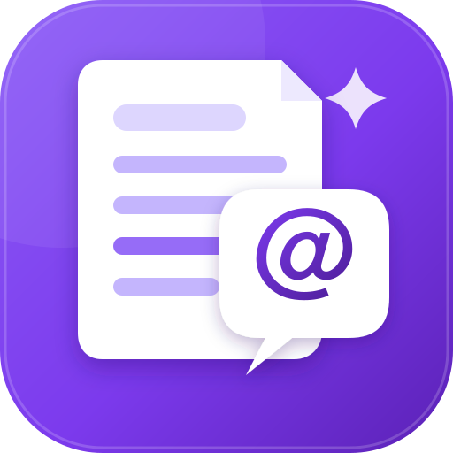
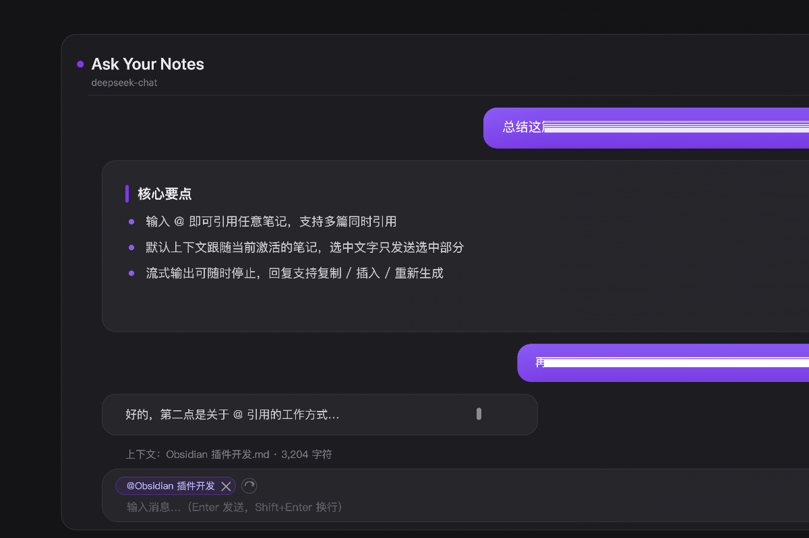

<p align="center">
  
</p>

<h1 align="center">Ask Your Notes</h1>

<p align="center">
  <strong>Chat with your notes, inside Obsidian.</strong><br/>
  An LLM chat panel for <a href="https://obsidian.md/">Obsidian</a> that sends the note you're working on
  as context — or any note you <code>@</code>-mention. Works with DeepSeek, OpenAI, OpenRouter,
  Ollama and any OpenAI-compatible API.
</p>

<p align="center">
  <a href="https://github.com/Howzits/obsidian-ask-your-notes/releases/latest"></a>
  <a href="https://github.com/Howzits/obsidian-ask-your-notes/blob/main/LICENSE"></a>
  <a href="https://github.com/Howzits/obsidian-ask-your-notes/stargazers"></a>
  <a href="https://obsidian.md/"></a>
</p>

## ✨ Features

- 💬 **Chat panel in the sidebar** — replies rendered as Markdown (code blocks, tables, lists, math)
- 📄 **Active note as context** — reads the editor buffer, so unsaved edits are included
- 🏷️ **`@`-mention any note** — reference other notes, several at once, or none at all
- ✂️ **Selection-aware** — select a passage and only that selection is sent
- 🌊 **Streaming replies** with a stop button; graceful fallback to non-streaming on mobile
- 🔁 **Regenerate, copy or insert** any reply into the current note
- 🧠 **Persistent history** across restarts (configurable)
- 🔌 **Provider presets** — DeepSeek, OpenAI, OpenRouter, Ollama (local), or any custom endpoint
- 🌍 **English / 中文** UI, auto-detected from your system language
- 🔒 Your API key stays in local plugin data — it only ever goes to the API you configure

## 📸 Screenshot



## 🚀 Installation

### Community plugins (marketplace)

🚧 Submitting to the Obsidian community plugin marketplace — coming soon.

### BRAT

1. Install [BRAT](https://github.com/TfTHacker/obsidian42-brat)
2. *Add a beta plugin* → paste `Howzits/obsidian-ask-your-notes`

### Manual

1. Download `main.js`, `manifest.json` and `styles.css` from the [latest release](https://github.com/Howzits/obsidian-ask-your-notes/releases/latest)
2. Copy them into `<vault>/.obsidian/plugins/ask-your-notes/`
3. Reload Obsidian and enable **Ask Your Notes** under *Settings → Community plugins*

### From source

```bash
git clone https://github.com/Howzits/obsidian-ask-your-notes.git
cd obsidian-ask-your-notes
npm install
npm run build
```

Then copy the three files as above.

## ⚙️ Configuration

Open *Settings → Ask Your Notes* and pick a provider:

| Provider | Endpoint | Example model |
| --- | --- | --- |
| DeepSeek | `https://api.deepseek.com/chat/completions` | `deepseek-chat` |
| OpenAI | `https://api.openai.com/v1/chat/completions` | `gpt-4o-mini` |
| OpenRouter | `https://openrouter.ai/api/v1/chat/completions` | `openai/gpt-4o-mini` |
| Ollama (local) | `http://localhost:11434/v1/chat/completions` | `llama3.1` |
| Custom | any OpenAI-compatible endpoint | any |

Use **Test connection** to verify before chatting.

## 📖 Usage

Open the chat from the ribbon icon or the **Open Ask Your Notes** command.

### Context modes

- **Follow the active note** *(default)* — a chip above the input shows which note will be sent; switch notes and it follows
- **`@`-mention notes** — type `@` in the input and pick from the vault; reference several notes for multi-note context
- **No context** — remove the chip (`×`), or turn off *Use the active note as context* in settings; the `↺` button restores auto-follow
- **Selection** — with *Prefer selected text* on, selected text is sent instead of the whole note

### Shortcuts

| Action | How |
| --- | --- |
| Send | `Enter` |
| New line | `Shift+Enter` |
| Reference a note | type `@`, pick from the list |
| New chat | `+` button in the header |
| Stop generation | stop button |

### Tips

- Select text in the editor and ask "explain this" — only the selection is sent
- Long notes are truncated at *Max context characters* (default 30,000)
- Replies are Markdown: hover one to **copy**, **insert** it at the cursor, or **regenerate**

## 🛠️ Development

```bash
npm install
npm run dev         # watch mode
npm run build       # type-check + production bundle
```

Reload Obsidian (`Cmd/Ctrl+R`) after each rebuild. The plugin is plain TypeScript bundled by esbuild — no framework.

## 📦 Releasing

Bump `version` in `manifest.json`, `package.json` and `versions.json`, then push a matching tag:

```bash
git tag 1.2.1 && git push origin 1.2.1
```

The GitHub Actions workflow builds and attaches `main.js`, `manifest.json` and `styles.css` to the release.

## 📃 Changelog

See [CHANGELOG.md](CHANGELOG.md).

## 🗺️ Roadmap

- [ ] Obsidian community plugin marketplace listing
- [ ] More provider presets (Anthropic, Gemini, SiliconFlow, …)
- [ ] More UI languages
- [ ] Image / attachment support for providers that allow it
- [ ] Per-conversation context pinning

## 🤝 Contributing

Contributions are welcome — bug reports, feature ideas and pull requests.

1. Fork the repository and create a feature branch
2. Keep changes focused; run `npm run build` before submitting
3. Open a pull request explaining the change and why

For bug reports, please include your Obsidian version, platform, provider, and what you expected vs. what happened.

## 📄 License

[MIT](LICENSE) © Howzits

---

## 中文说明

在 Obsidian 里与任意 OpenAI 兼容的 LLM 对话，**当前笔记即上下文**，也可以用 `@` 引用其他笔记。

### 功能

- 侧边栏聊天，AI 回复以 Markdown 渲染（代码块、表格、列表、公式）
- 默认以当前激活的笔记为上下文（包含未保存的修改）；选中文字时只发送选中部分
- 输入框输入 `@` 弹出笔记列表，可引用多篇笔记；chip 上的 `×` 移除引用，`↺` 恢复默认
- 桌面端流式输出、可随时停止；移动端自动降级
- 回复支持复制、插入到笔记光标处、重新生成；对话历史可持久化
- 内置 DeepSeek / OpenAI / OpenRouter / Ollama 预设，支持任意自定义端点
- 界面支持中文 / English，默认跟随系统

### 安装

- **插件市场**：正在提交，敬请期待
- **BRAT**：*Add a beta plugin* 填入 `Howzits/obsidian-ask-your-notes`
- **手动**：从 [Releases](https://github.com/Howzits/obsidian-ask-your-notes/releases/latest) 下载三个文件，放入 `<你的库>/.obsidian/plugins/ask-your-notes/`，重启 Obsidian 并启用

### 配置与使用

设置 → Ask Your Notes，选择服务商并填入 API Key，点「测试连接」确认可用。
Enter 发送，Shift+Enter 换行；输入 `@` 引用笔记；悬停回复可复制、插入、重新生成。

### 许可证

[MIT](LICENSE)
