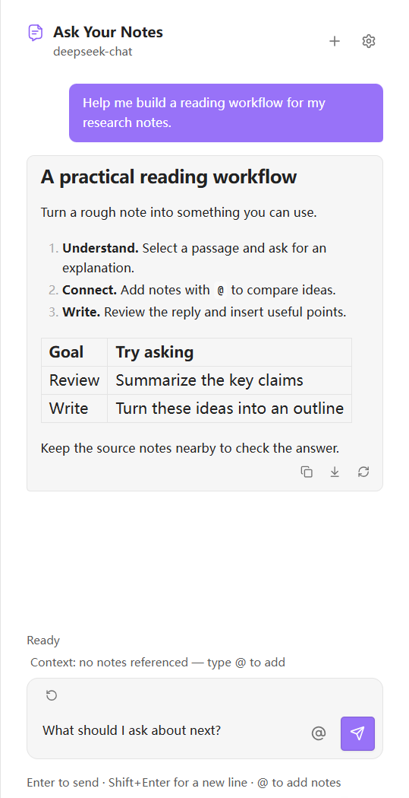

# Ask Your Notes

[English](README.md) · [下载版本](https://github.com/Howzits/obsidian-ask-your-notes/releases/latest) · [反馈问题](https://github.com/Howzits/obsidian-ask-your-notes/issues)

**在 Obsidian 里阅读、追问和整理笔记。**

将当前笔记、一段选中文字，或几篇参考笔记带入侧栏对话，用来总结内容、解释概念、比较观点和整理大纲。发送前，可以在输入框上方查看和移除引用。

插件提供聊天界面，你需要自行配置模型服务。内置 DeepSeek、OpenAI、OpenRouter 和 Ollama 预设，也支持自定义 OpenAI 兼容接口。插件不会自动检索或索引整个知识库。

> 本文介绍当前源码的功能。已安装版本支持哪些功能，请以对应的[发布说明](https://github.com/Howzits/obsidian-ask-your-notes/releases)为准。

## 主要功能

- **围绕当前笔记提问**：包含未保存的编辑内容；自动模式下，可优先发送选中的段落。
- **用 `@` 选择参考笔记**：支持多篇 Markdown 笔记，也可以移除全部引用后直接聊天。
- **将回复用于写作**：支持 Markdown、表格、代码和公式；可复制回复、插入编辑器当前选区或光标处，或重新生成最近一条回复。
- **清楚的请求状态**：显示读取、生成和停止状态，请求失败后可重试。
- **跟随 Obsidian 主题**：背景、文字、强调色、字体、图标和主要控件圆角随主题变化；界面支持中文和英文。
- **继续上次对话**：可选择在本地保存历史，重启后恢复。

## 界面预览

<picture>
  <source media="(prefers-color-scheme: dark)" srcset="assets/screenshot-dark.png" />
  
</picture>

在 Obsidian 中使用演示对话截取，未包含私人笔记，也未发送 API 请求。预览图会随明暗模式切换，实际外观随主题变化。

## 安装

在社区插件目录上架前，可通过 BRAT 或手动安装使用。

### 通过 BRAT 安装

1. 安装并启用 [BRAT](https://github.com/TfTHacker/obsidian42-brat)。
2. 选择 **Add a beta plugin**，填写 `Howzits/obsidian-ask-your-notes`。
3. 如未自动启用，到 **设置 → 第三方插件** 中启用 **Ask Your Notes**。

### 手动安装

1. 从[最新 Release](https://github.com/Howzits/obsidian-ask-your-notes/releases/latest) 下载附件 `main.js`、`manifest.json` 和 `styles.css`。
2. 在库中创建 `.obsidian/plugins/ask-your-notes/`，将三个文件放入该目录。
3. 重新加载 Obsidian，在 **设置 → 第三方插件** 中启用插件。

请下载 Release 附件，而不是 GitHub 自动提供的源码 ZIP。从源码构建的方法见下方[开发说明](#开发说明)。

## 开始使用

1. 打开 **设置 → Ask Your Notes**，选择服务商。
2. 按需填写 API Key，确认 API 地址和模型名称，点击 **测试连接**。测试会发送一条小请求，可能消耗 API 额度。
3. 打开一篇 Markdown 笔记，通过侧边工具栏图标或命令面板打开 **Ask Your Notes**。
4. 检查输入框上方的引用，输入“用五个要点总结这篇笔记”等问题，按 `Enter` 发送。

使用 Ollama 时，需先启动本地服务并安装模型，填写该服务中可用的模型名称。`localhost` 指运行 Obsidian 的设备本身。

### 内置连接预设

以下是代码中的默认值，不代表推荐模型。API 地址和模型名称均可修改；可用性取决于服务商和账号。

| 预设 | Chat completions 地址 | 默认模型 |
| --- | --- | --- |
| DeepSeek | `https://api.deepseek.com/chat/completions` | `deepseek-chat` |
| OpenAI | `https://api.openai.com/v1/chat/completions` | `gpt-4o-mini` |
| OpenRouter | `https://openrouter.ai/api/v1/chat/completions` | `openai/gpt-4o-mini` |
| Ollama | `http://localhost:11434/v1/chat/completions` | `llama3.1` |
| 自定义 | 完整的 OpenAI 兼容 chat completions 地址 | 对应模型 ID |

填写完整的 chat completions 地址，不要只填基础 URL。切换服务商预设会清空原 API Key，需要重新填写。第三方服务可能收取请求费用。

## 控制发送的上下文

| 模式 | 下一次提问会附带什么 |
| --- | --- |
| 跟随当前笔记 | 当前 Markdown 笔记，包含未保存的修改；默认启用 |
| 选中文字 | 自动模式下，开启选区优先后，非空选区替代整篇笔记 |
| 手动引用 | 通过输入 `@` 或点击 **@** 按钮选择的笔记；首次添加时替代自动跟随，可继续添加多篇 |
| 不附带笔记 | 移除全部引用；或关闭自动上下文，并保持手动引用为空 |

点击引用名称可打开笔记；点击移除按钮可取消引用；点击重置箭头可恢复自动模式。关闭“携带当前笔记作为上下文”只会关闭自动附带，手动引用仍会发送。

每次请求还包含此前的对话消息。切换笔记或移除引用不会清除这些消息；更换研究主题或需要全新上下文时，请新建对话。

默认每篇笔记最多发送 **30,000 字符**，可在设置中修改。截断时，上下文栏会提示。引用很多笔记或保留很长对话时，仍可能超出模型的上下文窗口。

### 常用操作

| 操作 | 方式 |
| --- | --- |
| 发送消息 | `Enter` |
| 输入换行 | `Shift+Enter` |
| 添加参考笔记 | 输入 `@` 或点击 **@** 按钮，再选择笔记 |
| 停止回复 | 生成期间点击停止按钮 |
| 新建对话 | 点击顶部 **+**，会清空当前对话 |
| 使用回复 | 点击复制或插入按钮；最近一条回复可重新生成 |

桌面端支持流式输出；移动端使用非流式请求。停止非流式请求会结束本地等待并丢弃后续结果，但不能取消底层网络请求，也不保证服务商停止计算或计费。

## 隐私与数据

- **发送内容**：问题、此前的对话消息、系统提示词，以及附带的笔记内容或选区，会发送至你配置的 API 地址。填写 API Key 时，密钥会作为授权请求头发送至该地址。
- **本地存储**：设置和密钥以明文保存在 `.obsidian/plugins/ask-your-notes/data.json`；启用历史保存后，该文件还会保存最近一次对话，最多保存 200 条消息。
- **历史控制**：关闭历史保存会清除已保存的历史，但保留内存中的当前对话；新建对话会清空当前对话，目前没有多会话归档。
- **同步与 Git**：如不希望密钥和聊天记录被复制，请在共享备份、同步和版本管理中排除 `data.json`。插件不会加密该文件。
- **服务商处理**：请求如何被处理和保留，由你选择的服务商决定。使用本机 Ollama 地址时，模型请求可以留在本机。

模型回答和生成的笔记链接可能有误。用于研究、写作或插入笔记前，请核对原始内容。

## 常见问题

| 问题 | 排查方式 |
| --- | --- |
| 测试连接失败 | 检查完整 API 地址、密钥、模型权限和网络；切换服务商后重新填写密钥 |
| 引用了错误的笔记 | 检查输入框上方的引用，移除后重新选择，或重置为自动跟随 |
| 只使用了笔记的一部分 | 取消选区或关闭选区优先，并检查每篇笔记的字符上限 |
| 请求失败或超时 | 检查服务商后重试；生成请求超时为两分钟；上下文过长时可减少引用或新建对话 |
| 新问题受到旧话题影响 | 新建对话；切换笔记不会移除历史消息 |

[反馈问题](https://github.com/Howzits/obsidian-ask-your-notes/issues)时，请提供 Obsidian 和插件版本、平台、服务商与模型、复现步骤和错误提示。请移除 API Key 和私人笔记内容。

## 开发说明

项目使用 TypeScript 和 esbuild，不依赖前端框架。当前依赖已使用 **Node.js 22.23.4** 和 npm 验证。

```bash
git clone https://github.com/Howzits/obsidian-ask-your-notes.git
cd obsidian-ask-your-notes
npm ci
npm run build
npm test
```

将 `main.js`、`manifest.json`、`styles.css` 复制到开发库的插件目录。运行时无需另行复制 Logo 文件。`npm run dev` 可监听源码变化；重新构建后，在 Obsidian 中重新加载插件。

修改矢量 Logo 母版后，运行 `npm run build:brand` 更新展示用 SVG。详见[资源说明](assets/README.md)；版本历史见 [CHANGELOG.md](CHANGELOG.md)。

欢迎提交问题和改进。提交 PR 前请运行 `npm run build` 和 `npm test`，并说明改动行为与验证方式。

## 许可证

[MIT](LICENSE)。
